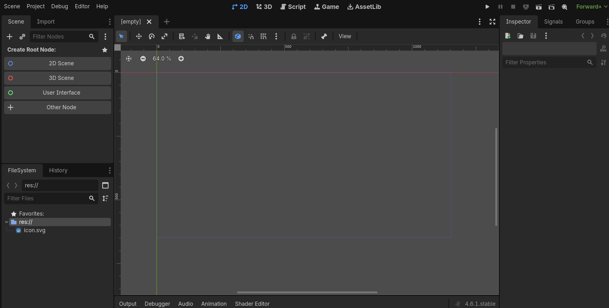
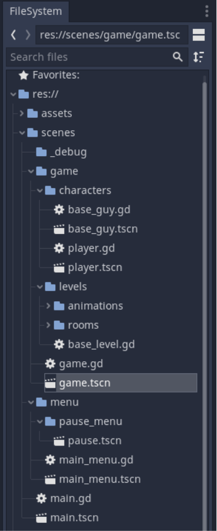
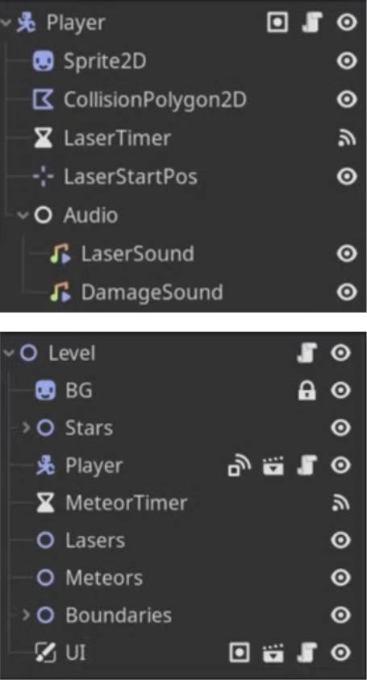
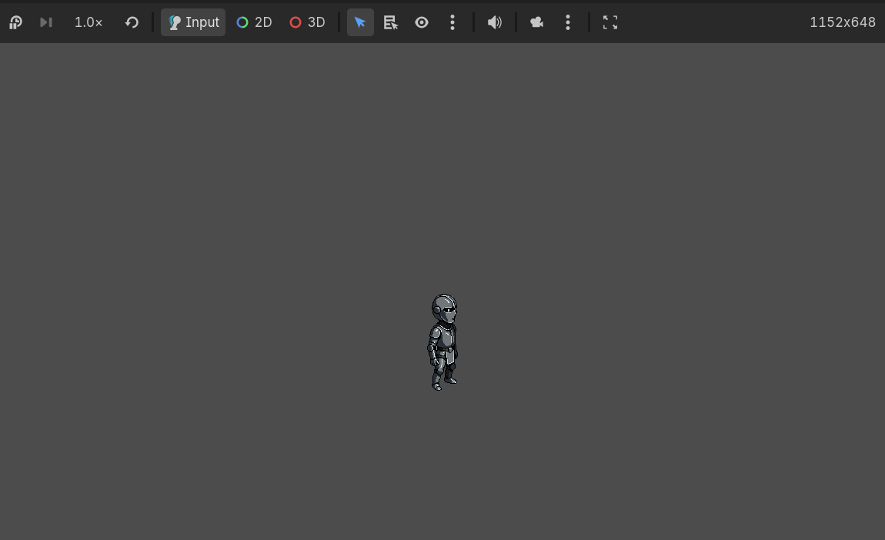
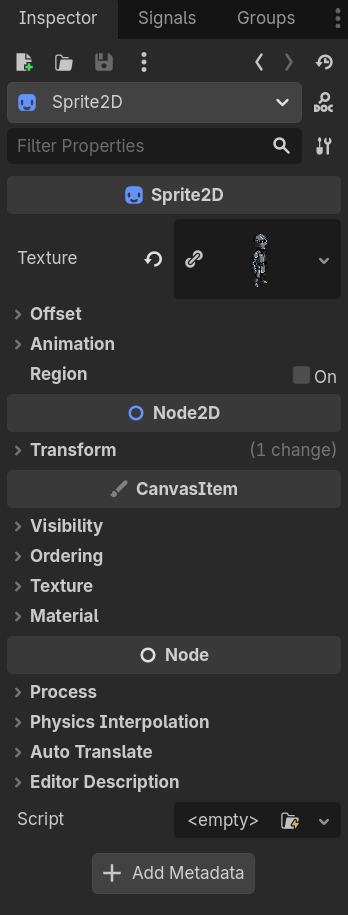
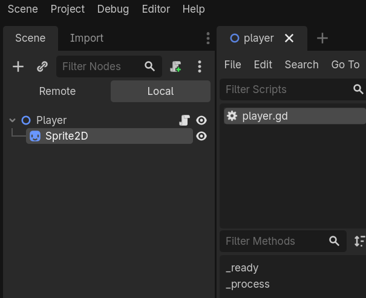
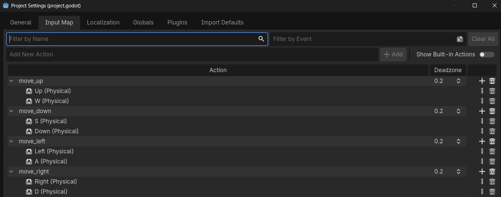

# Godot Foundations & Player Input
**Building Your First Interactive 2D Player**

- Introduction to the Godot game engine
- Understanding scenes, nodes, and the editor
- Creating a reusable Player scene
- Programming player movement with GDScript
- Handling keyboard input to control a character

**Session Goal:** Build a simple 2D player that responds to keyboard input and moves around the game screen.

---

# What Makes a Game Interactive?

An interactive game responds to player input and changes its behavior accordingly.

---

What Is Godot?

Godot is a free, open-source game engine used to create 2D and 3D games.

**Why use Godot?**
- Designed for both 2D and 3D development.
- Uses a scene-based development system.
- Provides a built-in code editor.
- Supports GDScript, a beginner-friendly scripting language.
- Allows developers to test games directly in the editor.

---

# Exploring the Godot Interface

The Godot editor contains several important areas:


**1. Scene Tree**
Displays the nodes belonging to the currently open scene.

**2. FileSystem**
Shows project files, including scripts, scenes, images, and other resources.

**3. Inspector**
Displays the properties of the selected node or resource.

**4. 2D Viewport**
Provides a workspace for positioning and arranging 2D objects.

**5. Script Editor**
Allows you to write and edit GDScript code.


---

# Understanding Project Structure

**How Is a Godot Project Organized?**



A Godot project contains the files and resources needed to build a game.

Example project structure:

```text
MyFirstGame/
├── project.godot
├── scenes/
│   ├── Main.tscn
│   └── Player.tscn
├── scripts/
│   └── player.gd
└── assets/
    └── player.png
```

**What do these files represent?**

- `project.godot`: Stores project configuration and settings.
- `Main.tscn`: Contains the main game scene.
- `Player.tscn`: Contains the reusable player scene.
- `player.gd`: Contains the player's behavior.
- `player.png`: Provides the player's visual appearance.

**Remember:** Organizing files into folders makes projects easier to manage as they grow.

---

# Scenes vs. Nodes


### What is a Node?
A node is a basic building block that provides a particular function.
Examples:
- `Node2D`: Provides a 2D transformation for objects.
- `Sprite2D`: Displays a 2D texture.
- `Camera2D`: Controls the game's 2D camera view.
- `CollisionShape2D`: Defines a collision shape for physics objects.

### What is a Scene?
A scene is a collection of nodes organized into a hierarchy that can be saved and reused.

Examples:
- Player scene
- Enemy scene
- Main game scene
- Menu scene

**Key Difference:**
A node is a building block; a scene organizes nodes into a reusable unit.

**Think About It:**
A player character might be a scene containing a root node, a sprite, and a collision shape.

---

# Creating Our First Player Scene


Follow these steps:

1. Create a new scene.
2. Add a `Node2D` node as the root.
3. Rename it `Player`.
4. Add a `Sprite2D` node as its child.
5. Assign a texture to the `Sprite2D`.
6. Save the scene as `Player.tscn` inside the `scenes` folder.

Your Scene Tree should look like this:

```text
Player (Node2D)
└── Sprite2D
```

**Important:** The root node represents the player object, while the sprite provides its visual appearance.


---

# Understanding Node2D and Sprite2D

**What Do These Nodes Do?**

### Node2D
- Acts as a parent for 2D objects.
- Supports position, rotation, and scale.
- Provides a convenient root for a simple 2D player.

### Sprite2D
- Displays a 2D image or texture.
- Can be positioned relative to its parent.
- Provides the player's visible appearance.

**Example hierarchy:**

```text
Player (Node2D)
└── Sprite2D
```

Moving the `Player` node also moves its child sprite.

**Key Takeaway:**
Separating an object's behavior and organization from its appearance makes a scene easier to extend.

---

# Meet the Inspector


**Customize Objects Without Writing Code**

The Inspector allows you to view and edit properties of selected nodes and resources.

For a `Node2D`, you can change:
- Position
- Rotation
- Scale

For a `Sprite2D`, you can configure:
- Texture
- Offset
- Visibility
- Modulation and other visual properties

**Try It!**
1. Select the `Player` node.
2. Change its position.
3. Select the `Sprite2D` child.
4. Assign a texture.
5. Observe how the scene changes in the viewport.

**Remember:** The Inspector is useful for configuring objects visually before adding code.

---

# Adding a Script to the Player



**Give Your Player Behavior**

A node becomes interactive when we add logic that responds to input.

Steps:
1. Select the `Player` node.
2. Click **Attach Script**.
3. Name the script `player.gd`.
4. Keep the language set to GDScript.
5. Create the script.

Example:

```gdscript
extends Node2D

func _ready():
    print("Player is ready!")
```

**What does this code mean?**

- `extends Node2D`: The script inherits the functionality of `Node2D`.
- `_ready()`: Runs when the node and its children have entered the scene tree and are ready.
- `print()`: Writes a message to the Output panel.

**Try It!**
Run the scene and check the Output panel for the message.

---

# Introduction to GDScript Variables

**Store Information in Your Game**

Variables allow us to store values that our game can use.

Example:

```gdscript
extends Node2D

var speed: float = 200.0
var direction: Vector2 = Vector2.ZERO
```

**Understanding the code:**

- `var`: Declares a variable.
- `speed`: Stores the player's movement speed.
- `float`: Represents a number that can contain a decimal.
- `direction`: Stores a 2D direction vector.
- `Vector2.ZERO`: Represents the vector `(0, 0)`.

**Why use variables?**

Instead of hard-coding a movement speed throughout the script, we can store it once and adjust it easily.

**Try It!**
Change `speed` from `200.0` to `300.0`. We'll use this value when implementing movement.

---

# Understanding _process(delta)

**How Does Game Logic Run Every Frame?**

Godot provides a built-in function called `_process(delta)`.

```gdscript
func _process(delta: float) -> void:
    pass
```

- `_process()` runs every rendered frame while the node is processing.
- `delta` represents the elapsed time, in seconds, since the previous process frame.
- `pass` means there is currently no code to execute.

**Why is delta important?**

Computers can run games at different frame rates. Multiplying movement speed by `delta` helps keep movement consistent over time.

For example:

```gdscript
position.x += 200.0 * delta
```

This moves the node horizontally at approximately 200 pixels per second.

**Key Formula:**

`Distance = Speed × Time`

---

# Understanding Input Actions

**How Does Godot Detect Player Input?**


Godot lets us define named input actions instead of checking specific keys throughout our game code.

Examples:
- `move_left`
- `move_right`
- `move_up`
- `move_down`

### Configure Input Map

1. Open **Project → Project Settings**.
2. Select the **Input Map** tab.
3. Add the four actions listed above.
4. Assign keyboard keys to each action.

Suggested key bindings:

| Action | Key |
|---|---|
| `move_left` | A or Left Arrow |
| `move_right` | D or Right Arrow |
| `move_up` | W or Up Arrow |
| `move_down` | S or Down Arrow |

**Why use Input Map?**

- Supports multiple keys for one action.
- Makes controls easier to change.
- Keeps input handling separate from key-specific details.


---

# Reading Input in GDScript

**Detect the Direction the Player Wants to Move**

Godot provides `Input.get_axis()` to read two opposing input actions.

Example:

```gdscript
var horizontal := Input.get_axis(
    "move_left",
    "move_right"
)

var vertical := Input.get_axis(
    "move_up",
    "move_down"
)
```

**How does it work?**

- `horizontal` returns a value between `-1` and `1`.
- `vertical` returns a value between `-1` and `1`.
- Negative values represent the first action.
- Positive values represent the second action.
- A value of `0` means neither direction is being pressed, or opposing inputs cancel each other.

**Examples:**

| Input | Horizontal | Vertical |
|---|---:|---:|
| Press A | -1 | 0 |
| Press D | 1 | 0 |
| Press W | 0 | -1 |
| Press S | 0 | 1 |
| No input | 0 | 0 |

**Important:** In Godot's 2D coordinate system, positive Y points downward, so negative vertical input moves upward.

---

# Understanding Vector2

**Represent Movement in Two Dimensions**

A `Vector2` stores two components: X and Y.

```gdscript
var direction := Vector2(1, 0)
```

This represents a direction toward the right.

Other examples:

```gdscript
Vector2(-1, 0) # Left
Vector2(1, 0)  # Right
Vector2(0, -1) # Up
Vector2(0, 1)  # Down
Vector2.ZERO   # No movement
```

We can combine horizontal and vertical input into a single vector:

```gdscript
var direction := Vector2(horizontal, vertical)
```

**One Important Detail:**
Moving diagonally with this vector can produce a larger magnitude than moving horizontally or vertically.

Normalize the direction to keep diagonal movement at the same speed:

```gdscript
direction = direction.normalized()
```

**Key Takeaway:** `Vector2` makes it easy to represent and calculate 2D movement.

---

# Making the Player Move

**Combine Input, Direction, Speed, and Delta**

Add the following code to `player.gd`:

```gdscript
extends Node2D

@export var speed: float = 200.0

func _process(delta: float) -> void:
    var horizontal := Input.get_axis(
        "move_left",
        "move_right"
    )

    var vertical := Input.get_axis(
        "move_up",
        "move_down"
    )

    var direction := Vector2(horizontal, vertical).normalized()

    position += direction * speed * delta
```

How the Code Works

1. Read horizontal input.
2. Read vertical input.
3. Combine both values into a direction vector.
4. Normalize the vector to prevent faster diagonal movement.
5. Multiply the direction by speed and elapsed time.
6. Add the result to the player's position.

**Result:** The player can move in four directions and diagonally using the configured keys.

**Note:** This example uses direct position changes for a simple beginner exercise. Physics-based movement and collision handling can be introduced in a later session.

---

Let's Test Our Player!

**Time to Play!**

Follow these steps:

1. Save `player.gd`.
2. Save `Player.tscn`.
3. Create a `Main.tscn` scene with a `Node2D` root.
4. Instance the `Player.tscn` scene as a child of `Main`.
5. Save the main scene.
6. Set `Main.tscn` as the project's main scene if prompted.
7. Run the project.

**Test These Controls:**
- Press A or Left Arrow.
- Press D or Right Arrow.
- Press W or Up Arrow.
- Press S or Down Arrow.
- Try moving diagonally.

**Observe:**
Does the player move smoothly? Does diagonal movement have the same speed as horizontal movement?

---

# Debugging Common Problems

**What If the Player Does Not Move?**

Check the following:

**Problem 1: Input actions are missing**
- Open Project Settings → Input Map.
- Verify that all four actions exist.
- Confirm that the correct keys are assigned.

**Problem 2: The script is not attached**
- Select the Player node.
- Confirm that `player.gd` is attached to it.

**Problem 3: The player is invisible**
- Select `Sprite2D`.
- Check that a texture is assigned.
- Verify that the node is visible and within the game view.

**Problem 4: The wrong scene is running**
- Confirm that `Main.tscn` is the main scene.
- Verify that it contains an instance of `Player.tscn`.

**Problem 5: There is a script error**
- Check the debugger and Output panel.
- Verify the spelling of input action names.
- Make sure the script is saved.

**Debugging Tip:** Read the error message first. It often points directly to the problem.

---

# Save a Reusable Player Scene

**Build Once, Reuse Anywhere**

One of Godot's major strengths is scene reusability.

Our `Player.tscn` scene contains:
- A root `Node2D` node.
- A `Sprite2D` child.
- An attached movement script.
- A configurable movement speed.

We can instance this scene in:
- The main game scene.
- Different levels.
- Test environments.
- Other projects.

**Why is this useful?**

Changes made to the reusable player scene can be reflected in its instances, subject to any instance-specific overrides.

**Final Project Structure:**

```text
MyFirstGame/
├── project.godot
├── scenes/
│   ├── Main.tscn
│   └── Player.tscn
├── scripts/
│   └── player.gd
└── assets/
    └── player.png
```

**Remember:** Save your scenes and scripts regularly.

---
