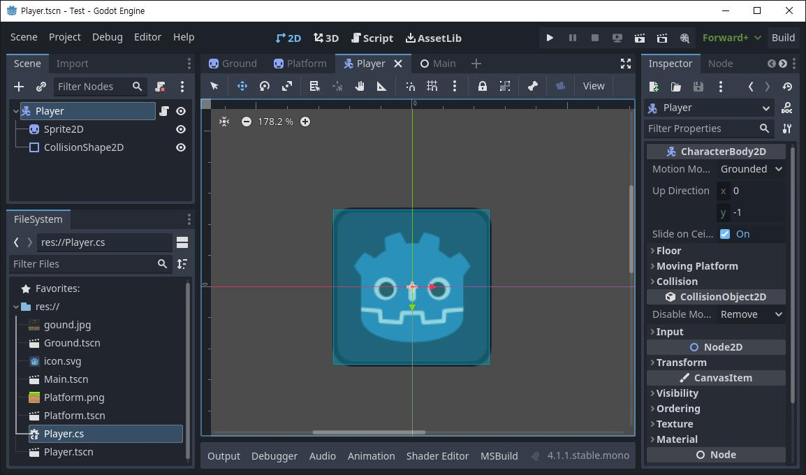
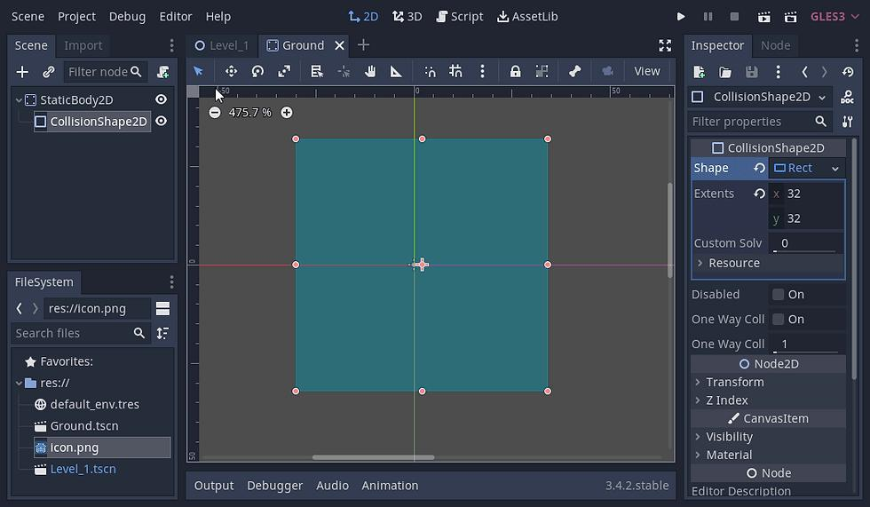
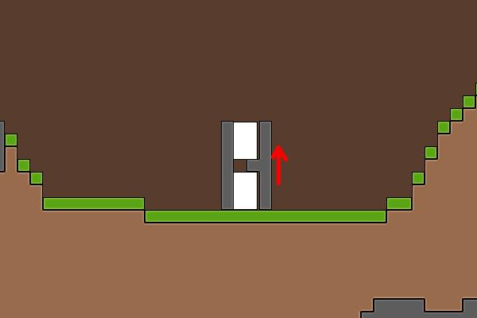
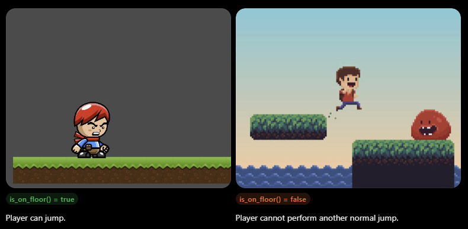
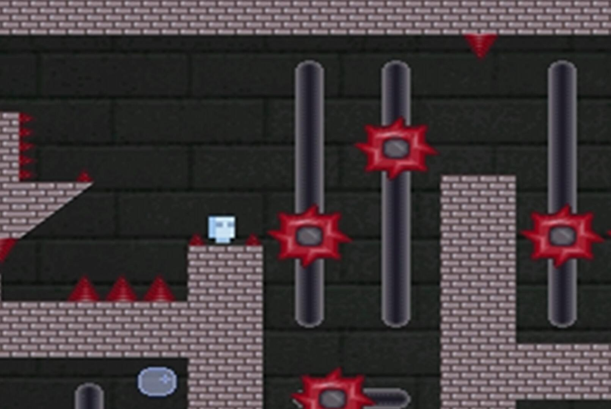
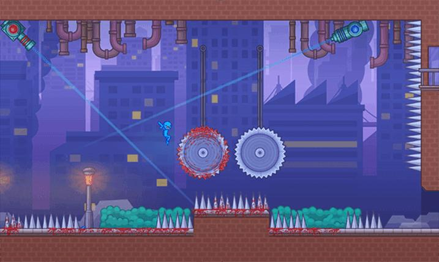

# Part 1: Understanding Physics in Godot

## Why Does a Character Fall Through the Floor?

Imagine creating a player using a `Sprite2D` and placing it above a floor.

You press Play, and the player falls straight through the floor!

**Why does this happen?**

A sprite is just a visual representation of an object. It does not automatically have a physical body or collision boundaries.

To create a working platformer, we need three important elements:

1. **Visual representation:** What the player looks like.
2. **Collision shape:** The area used to detect collisions.
3. **Physics body:** The node that participates in the physics simulation.


## Understanding the Main Physics Nodes

### CharacterBody2D

`CharacterBody2D` is used for characters that you control through code.

Examples:
- The player in a platformer.
- A character that walks and jumps.
- An enemy that follows the player.

It provides useful features for character movement and collision handling.

### CollisionShape2D

`CollisionShape2D` defines the shape used for collision detection.

Common shapes include:
- `RectangleShape2D`
- `CircleShape2D`
- `CapsuleShape2D`

The collision shape must have a shape resource assigned to it.

### StaticBody2D

`StaticBody2D` represents a physics object that normally remains stationary.


Examples:
- Floors.
- Platforms.
- Walls.
- Stationary obstacles.

### How they work together

Our player uses `CharacterBody2D` with a `CollisionShape2D`.

Our platform uses `StaticBody2D` with its own `CollisionShape2D`.

When the player moves downward and reaches the platform, Godot's physics system detects the collision.

---

# Part 2: Build the Player

## Create the Player Scene

Create a new scene with this node structure:

```text
Player (CharacterBody2D)
├── Sprite2D
└── CollisionShape2D
```

### Instructions

1. Create a new scene.
2. Add a `CharacterBody2D` as the root.
3. Rename it `Player`.
4. Add a `Sprite2D` as a child.
5. Add a `CollisionShape2D` as another child.
6. Assign a texture to the sprite if you have one.
7. Select `CollisionShape2D`.
8. In the Inspector, assign a `RectangleShape2D` or `CapsuleShape2D`.
9. Adjust its size to fit the player.

**Important:** The collision shape should approximately match the visible character.

If the shape is too small, the character may appear to sink into the floor. If it is too large, the character may appear to collide with invisible obstacles.

## Create the Platform

Create a platform scene with this structure:

```text
Platform (StaticBody2D)
├── Sprite2D
└── CollisionShape2D
```

### Instructions

1. Create a new scene.
2. Add a `StaticBody2D`.
3. Rename it `Platform`.
4. Add a `Sprite2D`.
5. Add a `CollisionShape2D`.
6. Assign a `RectangleShape2D`.
7. Adjust the rectangle to match the platform's size.

For a simple platform, the collision rectangle should cover the platform's top surface and body.

You can also create the platform directly inside your main level scene.

## Create the Main Level

Create a new scene:

```text
Main (Node2D)
├── Player (CharacterBody2D)
├── Floor (StaticBody2D)
├── Platform1 (StaticBody2D)
├── Platform2 (StaticBody2D)
└── Platform3 (StaticBody2D)
```

Place the player above the floor.

Place the three platforms at different heights so that the player can jump between them.

At this point, the player will not move automatically just because the collision nodes exist. We must implement movement and gravity.

---

# Part 3: Configure Input

## Set Up the Controls

Open:

**Project → Project Settings → Input Map**

Create the following actions:

| Action | Keys |
|---|---|
| `move_left` | A, Left Arrow |
| `move_right` | D, Right Arrow |
| `jump` | Space |

To add a key:

1. Enter the action name.
2. Click the plus button beside the action.
3. Press the key you want to assign.
4. Confirm the selection.

These actions allow us to refer to controls by name rather than checking individual keyboard keys in our code.

---

# Part 4: Add Gravity and Horizontal Movement

## How Gravity Works

Gravity pulls the player downward.

In a platformer, we simulate gravity by increasing the player's vertical velocity over time.

For example:

- At the beginning, vertical velocity may be zero.
- Gravity increases downward velocity.
- The player falls faster as time passes.
- When the player lands on a platform, the physics system handles the collision.

In Godot 2D:
- Positive Y points downward.
- Negative Y points upward.

Therefore, a positive vertical velocity makes the player move downward.

## First Movement Script

Attach this script to the `Player` node.

```gdscript
extends CharacterBody2D

@export var speed: float = 250.0
@export var gravity: float = 1200.0

func _physics_process(delta: float) -> void:
    var direction := Input.get_axis(
        "move_left",
        "move_right"
    )

    velocity.x = direction * speed

    if not is_on_floor():
        velocity.y += gravity * delta

    move_and_slide()
```

### Code Explaination

**`extends CharacterBody2D`**

The script controls a character body that supports scripted movement and collision handling.

**`@export var speed: float = 250.0`**

Defines the player's horizontal movement speed. It can be adjusted in the Inspector.

**`@export var gravity: float = 1200.0`**

Defines how quickly downward velocity increases while the player is airborne.

**`func _physics_process(delta: float) -> void:`**

Runs the movement code on Godot's physics update.

**`Input.get_axis("move_left", "move_right")`**

Returns:
- `-1` when moving left.
- `0` when neither direction is pressed.
- `1` when moving right.

**`velocity.x = direction * speed`**

Controls horizontal movement.

**`if not is_on_floor():`**

Checks whether the player is not standing on a floor or platform.

**`velocity.y += gravity * delta`**

Increases downward velocity over time while the player is airborne.

**`move_and_slide()`**
Moves the character using its velocity and handles collisions with the environment.


Run the scene.

1. Move left and right.
2. Walk off the platform.
3. Observe how the player falls.
4. Check whether the player lands on the floor.

At this stage, jumping has not been added.

---

# Part 5: Add Jumping

## How Jumping Works

A jump gives the player an initial upward velocity.

Since Godot's positive Y direction points downward, upward velocity must be negative.

For example:

```gdscript
velocity.y = -450.0
```

This launches the player upward.

Gravity then gradually reduces the upward movement until the player reaches the peak of the jump. The player subsequently begins falling.

A typical jump follows this sequence:

1. The player stands on the floor.
2. The player presses Space.
3. An upward velocity is applied.
4. Gravity acts on the player.
5. The player reaches the jump's peak.
6. The player falls.
7. The player lands on a platform.

## Add the Jump Input

Update the player's script:

```gdscript
extends CharacterBody2D

@export var speed: float = 250.0
@export var gravity: float = 1200.0
@export var jump_velocity: float = -450.0

func _physics_process(delta: float) -> void:
    var direction := Input.get_axis(
        "move_left",
        "move_right"
    )

    velocity.x = direction * speed

    if not is_on_floor():
        velocity.y += gravity * delta

    if Input.is_action_just_pressed("jump") and is_on_floor():
        velocity.y = jump_velocity

    move_and_slide()
```

### What is new?

**`@export var jump_velocity: float = -450.0`**

Controls the initial upward speed of the jump.

A more negative value generally produces a higher jump when gravity remains unchanged.

**`Input.is_action_just_pressed("jump")`**

Returns true on the frame when the jump action is first pressed.

This is useful for jumping because we usually want one jump when the player presses Space, rather than repeatedly applying a new jump every frame while Space is held.

**`and is_on_floor()`**

Requires the player to be on the floor before the jump can happen.


This prevents the player from repeatedly jumping in midair.

**`velocity.y = jump_velocity`**

Applies the initial upward velocity.

### Important teaching note

The order of these statements matters. In this example, gravity is applied first when the player is airborne, then the jump condition is checked. Because the jump also requires `is_on_floor()`, the player cannot start another jump while airborne.

`is_on_floor()` uses collision information from the character's movement. For a typical grounded character, checking it in the physics loop before the next `move_and_slide()` call is the standard pattern.

---

# Part 6: Understand and Adjust the Physics

## Experiment with Movement Values

Students should test different values using the Inspector.

| Variable | Starting Value | What Happens When You Increase It? |
|---|---:|---|
| `speed` | 250 | The player moves faster horizontally. |
| `gravity` | 1200 | The player falls faster and usually spends less time in the air. |
| `jump_velocity` | -450 | Making it more negative increases the jump's height. |

For example:

**Experiment A:** Set `jump_velocity` to `-350.0`.

Observe the jump height.

**Experiment B:** Set `jump_velocity` to `-600.0`.

Observe how much higher the player jumps.

**Experiment C:** Increase gravity from `1200.0` to `1600.0`.

Observe how quickly the player falls.

"What happens if we make the jump stronger but also increase gravity?"
The player initially moves upward faster, but gravity pulls them back down more strongly. The resulting jump depends on both values.

---

# Part 7 Activity: Mini Platformer

## Build a Three-Platform Level

### Mini Platformer

**Objective:** Create a level where the player can walk, jump, and land on three platforms.

### Requirements

1. Create a player with a `CharacterBody2D` and `CollisionShape2D`.
2. Create a floor with a `StaticBody2D` and `CollisionShape2D`.
3. Create three platforms with collision shapes.
4. Add horizontal movement.
5. Add gravity.
6. Add jumping that works only while the player is on the floor.
7. Arrange the platforms at different heights.
8. Test the level from beginning to end.

### Suggested layout

```text
                    [Platform 3]


           [Platform 2]


     [Platform 1]


================================
             FLOOR
```

### Success criteria

The player can:
- Walk left and right.
- Fall when leaving a platform.
- Jump while grounded.
- Land on platforms without passing through them.
- Reach all three platforms.

---

# Part 8: Challenge

## Challenge A: Double Jump

Allow the player to jump twice before landing.

The player should be able to press Space once to jump, then press it again in midair for a second jump.

Replace the player's script with the following version:

```gdscript
extends CharacterBody2D

@export var speed: float = 250.0
@export var gravity: float = 1200.0
@export var jump_velocity: float = -450.0

var jumps_remaining: int = 2

func _physics_process(delta: float) -> void:
    var direction := Input.get_axis(
        "move_left",
        "move_right"
    )

    velocity.x = direction * speed

    if is_on_floor():
        jumps_remaining = 2
    else:
        velocity.y += gravity * delta

    if Input.is_action_just_pressed("jump") and jumps_remaining > 0:
        velocity.y = jump_velocity
        jumps_remaining -= 1

    move_and_slide()
```

### Explain the new variable

`var jumps_remaining: int = 2`

Stores the number of jumps the player has left.

- On the floor, the player gets two jumps.
- The first jump reduces the count to one.
- The second jump reduces the count to zero.
- The player cannot jump again until landing.


## Challenge B: Moving Hazard
 

Create a hazard that travels horizontally between two points.

Node structure:

```text
Hazard (Area2D)
├── Sprite2D
└── CollisionShape2D
```

Animate the hazard using an `AnimationPlayer` or move it using a script.

For a simple scripted hazard:

```gdscript
extends Area2D

@export var move_distance: float = 150.0
@export var move_speed: float = 100.0

var start_x: float

func _ready() -> void:
    start_x = position.x

func _process(delta: float) -> void:
    position.x += move_speed * delta

    if position.x >= start_x + move_distance:
        move_speed = -abs(move_speed)

    elif position.x <= start_x:
        move_speed = abs(move_speed)
```

This makes the hazard move between two horizontal positions.

To make contact dangerous, students can connect the `Area2D`'s `body_entered` signal and respond when the player enters the hazard.

---

# Part 9: Common Problems

## Why Does the Player Fall Through the Floor?

Check the following:

- Does the player have a `CharacterBody2D` root?
- Does the player have a `CollisionShape2D` with a valid shape assigned?
- Does the floor have a `StaticBody2D`?
- Does the floor have a `CollisionShape2D`?
- Are the collision shapes positioned correctly?
- Are the relevant collision layers and masks configured to detect each other?
- Is `move_and_slide()` being called during the physics update?

## Why Can't the Player Jump?

Check the following:

- Is the `jump` action configured in the Input Map?
- Is Space assigned to the action?
- Does the player stand on a platform with a valid collision shape?
- Is the jump condition checking `is_on_floor()`?
- Is the jump velocity negative?
- Is `move_and_slide()` being called?

## Why Does the Player Fall Too Quickly?

The gravity value may be too high.

Try lowering it.

For example:

```gdscript
@export var gravity: float = 900.0
```

Remember that the gravity value in this script is an acceleration in pixels per second squared.

## Why Is the Jump Too Low?

Try making the jump velocity more negative.

For example:

```gdscript
@export var jump_velocity: float = -550.0
```

The final result depends on both jump velocity and gravity.

---


# Final Review

1. What is the difference between `CharacterBody2D` and `StaticBody2D`?
2. Why does a player need a `CollisionShape2D`?
3. What does gravity do to vertical velocity?
4. Why is jump velocity negative in Godot 2D?
5. What does `is_on_floor()` check?
6. Why do we use `move_and_slide()`?
7. How can you make a jump higher or lower?

