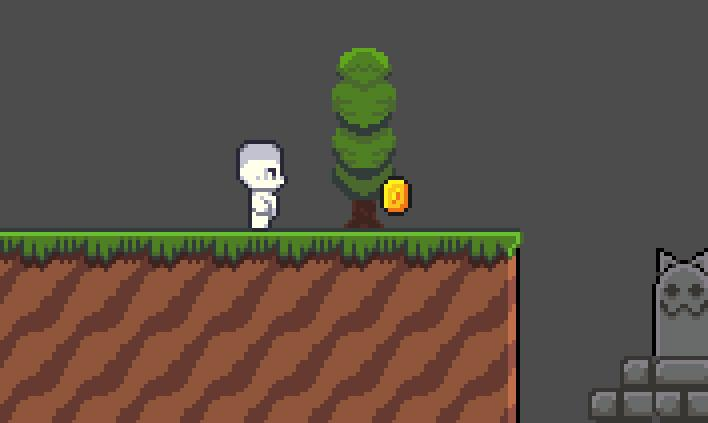
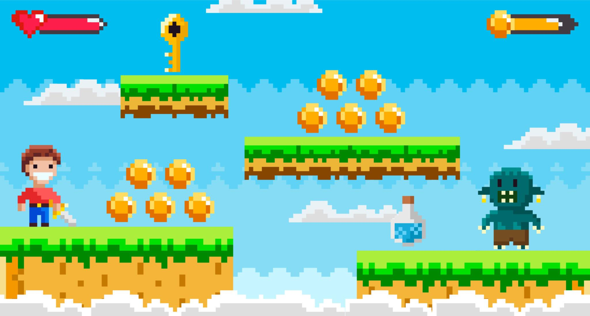
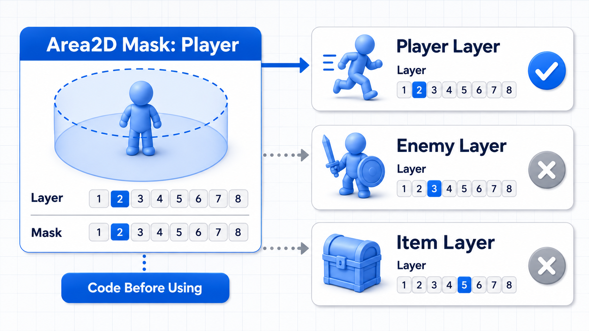
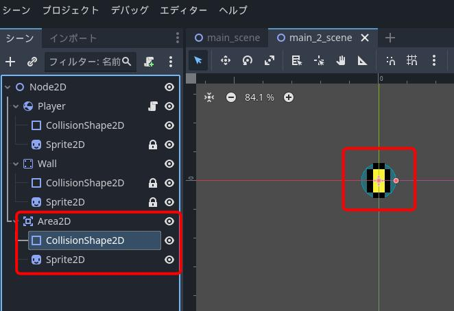
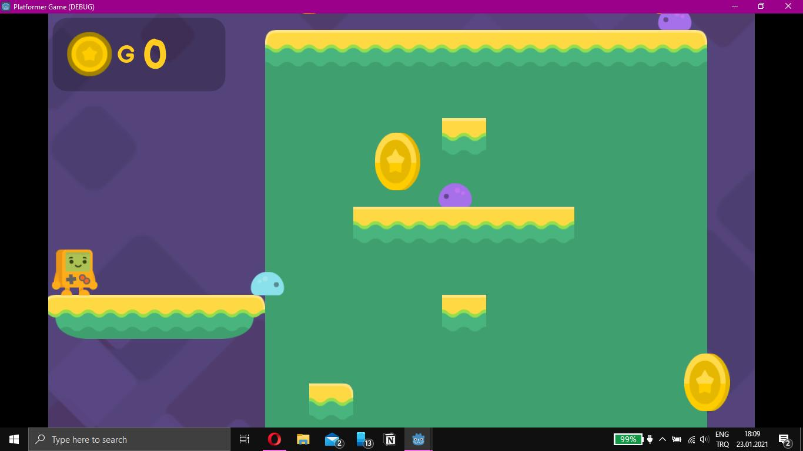
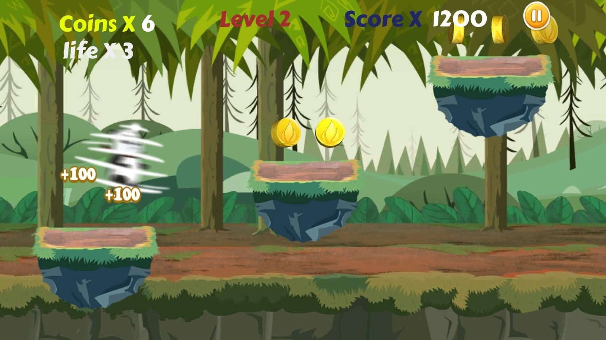

# 🎮 Godot Session: Interactions, Signals & Collectibles

Engine: Godot 4\
Level: Beginner\
Project: Coin Collector

## 1. Learning Objectives

By the end of this session, students will be able to:

- Understand how Godot detects interactions between game objects.
- Explain the difference between `Area2D` and physics bodies.
- Create reusable collectible scenes.
- Understand and connect signals.
- Use `body_entered` to detect when the player touches a coin.
- Understand collision layers and masks.
- Use Groups to identify specific objects.
- Remove collected objects using `queue_free()`.
- Create a score system.
- Display the score using a `Label`.
- Implement a simple winning condition.

# Part 1  Understanding Interactions

## How Does the Game Know the Player Touched a Coin?

Imagine a platformer game where the player moves around and collects coins.

<div style="display: flex; gap: 10px;">
  
  
</div>

How does the game know that the player has touched a coin?

The answer is that Godot can detect when two objects overlap using a special node called `Area2D`.

When the player enters the coin's detection area, Godot can trigger an event.

That event can:

1. Detect the player.
2. Add points to the score.
3. Remove the coin from the game.

This is an example of interaction between game objects.

## What Is Area2D?

`Area2D` is a Godot node used to detect when other physics bodies or areas enter, exit, or overlap a specific region.

Unlike a normal physical collision body, `Area2D` does not block the player's movement.

Examples:

- A coin detects when the player touches it.
- A health pickup detects when the player collects it.
- A checkpoint detects when the player reaches it.
- A door detects when the player enters its area.

<div style="display: flex; gap: 10px;">
  
</div>


### Important Difference

| Node              | Purpose                                   | Example               |
| ----------------- | ----------------------------------------- | --------------------- |
| `StaticBody2D`    | Physical object that blocks movement      | Wall, floor           |
| `CharacterBody2D` | Character controlled through code         | Player                |
| `Area2D`          | Detects overlap without blocking movement | Coin, pickup, trigger |

Should a coin block the player's movement?

No. The player should be able to touch and collect the coin, not collide with it like a wall.

That's why we use `Area2D`.

## What Is CollisionShape2D?

`CollisionShape2D` defines the shape used for detecting collisions or overlaps.

Common shapes include:

- `CircleShape2D`
- `RectangleShape2D`
- `CapsuleShape2D`

For a coin, a `CircleShape2D` is usually a good choice.



A typical coin scene looks like this:

```
Coin (Area2D)
├── Sprite2D
└── CollisionShape2D
```

- `Sprite2D` displays the coin.
- `CollisionShape2D` defines the region where the player can collect it.

Important: A collision shape needs a valid shape resource assigned in the Inspector.

# Part 2 Create the Coin Scene

## Build a Reusable Coin

We will create a separate scene for the coin so that we can reuse it throughout the game.

### Step 1: Create a New Scene

1. Click Scene → New Scene.
2. Add an `Area2D` as the root node.
3. Rename it `Coin`.
4. Add a `Sprite2D` as a child.
5. Add a `CollisionShape2D` as another child.

Your structure should look like this:

```
Coin (Area2D)
├── Sprite2D
└── CollisionShape2D
```

### Step 2: Configure the Collision Shape

1. Select `CollisionShape2D`.
2. Open the Inspector.
3. Assign a `CircleShape2D`.
4. Adjust the circle size to cover the coin.

### Step 3: Save the Scene

Save it as:

```
scenes/coin.tscn
```

Now the coin is a reusable scene.

You can instance it multiple times in your level without rewriting its code.

## What Are Reusable Scenes?

Imagine creating ten coins in a game.

One approach is to create each coin individually. However, this creates unnecessary work.

Instead, create one reusable Coin scene and instance it ten times.

<div style="display: flex; gap: 10px;">
  
</div>


Benefits:

- Saves development time.
- Keeps the project organized.
- Makes updates easier.
- Allows you to reuse the same behavior.

For example, if you change the coin's collection behavior in the original scene, all instances use that updated behavior.

# Part 3  Understanding Signals

## What Is a Signal?

A signal is an event message sent when something happens in Godot.

Think of a signal as saying:

"Something happened. If someone is listening, call the function connected to this event."

Examples:

| Event                 | Signal         |
| --------------------- | -------------- |
| Player enters an area | `body_entered` |
| Player exits an area  | `body_exited`  |
| Button is clicked     | `pressed`      |
| Timer finishes        | `timeout`      |

For our coin:

When the player touches the coin, the `body_entered` signal is emitted.

We connect that signal to a function that collects the coin.

## Connect the body_entered Signal

Select the `Coin` node, which is an `Area2D`.

1. Open the Node tab beside the Inspector.
2. Find the `body_entered` signal.
3. Double-click it.
4. Select the Coin node as the receiver.
5. Click Connect.

Godot will generate a function similar to:

```
func _on_body_entered(body: Node2D) -> void:
    pass
```

### Code Explaination

- `func` declares a function.
- `_on_body_entered` is the function name.
- `body` represents the physics body that entered the coin's area.
- `Node2D` is the type of the incoming object.
- `pass` means there is currently no code inside the function.

We will replace `pass` with our collection logic.

## Detect the Player Using Groups

We don't want every object that touches the coin to collect it.

For example, an enemy might touch the coin.

We only want the player to collect it.

One way to identify the player is by using Groups.

### What Are Groups?

Groups allow us to organize nodes under a shared name.

Examples:

- `player`
- `enemies`
- `collectibles`
- `hazards`

We can then check whether an object belongs to a particular group.

### Add the Player to a Group

1. Open your Player scene.
2. Select the `Player` root node.
3. Open the Node tab.
4. Select Groups.
5. Add a group named `player`.

Make sure the group name is exactly:

```
player
```

Now the player belongs to the `player` group.

## Check Whether the Player Entered the Coin

Add this script to the Coin scene:

```
extends Area2D

func _on_body_entered(body: Node2D) -> void:

    if body.is_in_group("player"):
        print("Coin collected!")
```

### Code Explaination

`extends Area2D`

The script belongs to the coin's detection area.

`func _on_body_entered(body: Node2D)`

Runs when a physics body enters the coin's detection area.

`if body.is_in_group("player"):`

Checks whether the object that entered the area belongs to the `player` group.

`print("Coin collected!")`

Displays a message in the Output panel.

### Test It

1. Run the game.
2. Move the player toward a coin.
3. Touch the coin.
4. Check the Output panel.

You should see:

```
Coin collected!
```

If an object that is not in the player group enters the area, the message will not appear.

# Part 4 Collision Layers and Masks

## Understanding Collision Layers and Masks

Godot uses collision layers and masks to control which physics objects can detect or interact with each other.

Think of them as numbered categories.

- Collision Layer: Which category does this object belong to?
- Collision Mask: Which categories does this object detect?

For example:

| Object | Collision Layer | Collision Mask |
| ------ | --------------- | -------------- |
| Player | 1               | 2              |
| Coin   | 2               | 1              |
| Floor  | 1               | 1              |

In this example:

- The player belongs to layer 1 and detects layer 2.
- The coin belongs to layer 2 and detects layer 1.
- The floor belongs to layer 1.

The coin can detect the player because the player's layer is included in the coin's mask.

### Important Note

Collision layers and masks are not the same as Groups.

| Groups                           | Collision Layers and Masks                      |
| -------------------------------- | ----------------------------------------------- |
| Organize nodes by name           | Organize physics objects by numbered categories |
| Used to identify objects in code | Used to control physics detection and collision |
| Example: `player`                | Example: Layer 1                                |

For this beginner project, you can initially leave the default collision settings and use Groups to identify the player.

# Part 5 Remove the Coin

## What Is queue_free()?

After collecting a coin, we want it to disappear.

Godot provides:

```
queue_free()
```

This schedules the current node to be removed from the scene tree safely.

For example:

```
func _on_body_entered(body: Node2D) -> void:

    if body.is_in_group("player"):
        print("Coin collected!")
        queue_free()
```

### Code Explaination

1. The player enters the coin's area.
2. Godot triggers `body_entered`.
3. The function checks whether the object is the player.
4. If it is, a message is printed.
5. `queue_free()` removes the coin.

Why not just hide the coin?

Hiding a coin only makes it invisible. The node still exists in the scene tree.

`queue_free()` removes the node entirely.

# Part 6 Create the Score System

## Add a Score Variable

Now we want the player to earn points when collecting coins.

First, we need a variable to store the score.

For this beginner project, we will keep the score in the Main scene.

Our scene structure:

```
Main (Node2D)
├── Player (CharacterBody2D)
├── Coin
├── Coin
├── Coin
└── CanvasLayer
    └── ScoreLabel (Label)
```

Attach a script to the `Main` node.

```
extends Node2D

var score: int = 0

func add_score(points: int) -> void:
    score += points
    print("Score: ", score)
```

### Code Explaination

`var score: int = 0`

Creates a variable called `score`.

- `var`: declares a variable.
- `score`: variable name.
- `int`: stores whole numbers.
- `0`: starting score.

`func add_score(points: int)`

Creates a function that receives the number of points to add.

`score += points`

Adds the received points to the current score.

For example:

- Starting score: 0
- Collect first coin: 10 points
- Collect second coin: 10 points
- New score: 20 points

## Connect the Coin to the Score System

We need to tell the Main scene when a coin is collected.

One way is to use a custom signal emitted by the coin.

Update the Coin script:

```
extends Area2D

signal collected(points: int)

@export var coin_value: int = 10

func _on_body_entered(body: Node2D) -> void:

    if body.is_in_group("player"):
        collected.emit(coin_value)
        queue_free()
```

### New Concepts

`signal collected(points: int)`

Declares a custom signal named `collected`.

`@export var coin_value: int = 10`

Defines how many points this coin is worth.

`collected.emit(coin_value)`

Sends the signal and passes the coin's point value to whoever is listening.

Now we need to connect this signal to the Main scene.

## Connect the Custom Signal

In your Main scene, select the Coin instance.

1. Open the Node tab.
2. Find the `collected` signal.
3. Double-click it.
4. Connect it to the Main node.
5. Select the `add_score` function as the receiving method.

Godot will create a function similar to:

```
func _on_coin_collected(points: int) -> void:
    add_score(points)
```

Now when the coin emits its signal, Main receives the points and updates the score.

Important: Connect the signal for every coin instance, or connect it automatically when creating the coins. For a beginner scene with a few coins, connecting each one manually is fine.

# Part 7 Create the HUD

## What Is a HUD?

HUD stands for Heads-Up Display.

It displays important game information while the player is playing.

Examples:

- Score.
- Health.
- Remaining lives.
- Timer.
- Ammunition.



In our project, we will use a `Label` to display the score.

## Create the Score Label

1. Open the Main scene.
2. Add a `CanvasLayer` node.
3. Add a `Label` as its child.
4. Rename the Label to `ScoreLabel`.
5. Set its text to `Score: 0`.
6. Position it in the upper-left corner.

### Why use CanvasLayer?

It allows the HUD to remain in a consistent screen position rather than moving with the game world or camera.

## Update the Label

Update the Main script:

```
extends Node2D

var score: int = 0

@onready var score_label: Label = $CanvasLayer/ScoreLabel

func add_score(points: int) -> void:
    score += points
    score_label.text = "Score: " + str(score)
```

### Explain the New Code

`@onready`

Initializes the variable when the node is ready and its children are available.

`$CanvasLayer/ScoreLabel`

Gets the `ScoreLabel` node using its scene-tree path.

`score_label.text`

Changes the text displayed by the Label.

`str(score)`

Converts the integer score into a string so it can be combined with other text.

For example:

```
score_label.text = "Score: " + str(20)
```

Displays:

```
Score: 20
```

# Part 8 Add a Winning Condition

## Win When All Coins Are Collected

Our game should have an objective.

Let's say the player needs to collect three coins to win.

Update the Main script:

```
extends Node2D

var score: int = 0
var total_coins: int = 3

@onready var score_label: Label = $CanvasLayer/ScoreLabel

func add_score(points: int) -> void:
    score += points

    score_label.text = "Score: " + str(score)

    if score >= total_coins * 10:
        print("You Win!")
```

### Winning Condition

```
if score >= total_coins * 10:
```

This checks whether the score has reached the required amount.

If there are three coins worth 10 points each:

- First coin: 10 points.
- Second coin: 20 points.
- Third coin: 30 points.

When the score reaches 30, the game prints:

```
You Win!
```


# Part 9 Complete Project Code

## Coin Script

Attach this script to the root `Area2D` of the Coin scene.

```
extends Area2D

signal collected(points: int)

@export var coin_value: int = 10

func _on_body_entered(body: Node2D) -> void:

    if body.is_in_group("player"):
        collected.emit(coin_value)
        queue_free()
```

Remember to connect the `body_entered` signal to `_on_body_entered`.

## Main Script

Attach this script to the Main scene's root node.

```
extends Node2D

var score: int = 0
var total_coins: int = 3

@onready var score_label: Label = $CanvasLayer/ScoreLabel

func add_score(points: int) -> void:
    score += points

    score_label.text = "Score: " + str(score)

    print("Current score: ", score)

    if score >= total_coins * 10:
        print("You Win!")
```

Connect each coin's `collected` signal to the Main node's `add_score` function.

# Part 10 Challenge

## Challenge A — Key Unlocks an Exit

Objective: Create a key that the player must collect before opening an exit door.

Requirements:

1. Create a reusable Key scene using `Area2D`.
2. Add a `CollisionShape2D`.
3. Detect when the player collects the key.
4. Create a variable called `has_key`.
5. Set `has_key` to `true` when the player collects the key.
6. Create an exit door.
7. When the player touches the door, check whether `has_key` is true.
8. If true, open the door or display a winning message.
9. If false, display `"You need a key!"`.

Example:

```
var has_key: bool = false

func collect_key() -> void:
    has_key = true
    print("You found the key!")

func try_open_door() -> void:
    if has_key:
        print("Door unlocked!")
    else:
        print("You need a key!")
```

## Challenge B — Countdown Goal

Objective: Collect all coins before the timer reaches zero.

Requirements:

- Add a `Timer` node.
- Set its wait time to 30 seconds.
- Start the timer when the level begins.
- Display the remaining time using a Label.
- Stop the game when the timer reaches zero.
- Display a winning message if all coins are collected before time runs out.


# Part 11 Common Problems

## Why Is the Coin Not Detected?

Check:

- Is the Coin root node an `Area2D`?
- Does it have a `CollisionShape2D`?
- Is a valid shape assigned?
- Is `Monitoring` enabled on the Area2D?
- Does the coin's collision mask include the player's collision layer?
- Does the player have a physics body?
- Is the `body_entered` signal connected?

## Why Is the Score Not Increasing?

Check:

- Does the Player belong to the `player` group?
- Is the group name spelled correctly?
- Is the Coin's `body_entered` signal connected?
- Is the custom `collected` signal emitted?
- Is the `collected` signal connected to Main?
- Is the `add_score()` function receiving the points?

## Why Is the Coin Not Disappearing?

Make sure this line is executed:

```
queue_free()
```

Also check that the player group condition is true.

Remember:

- `hide()` makes the node invisible.
- `queue_free()` removes the node from the scene tree.


# Part 12 Final Review

### Final Checkpoint

- Create a collectible scene.
- Connect a signal.
- Identify the player using a Group.
- Detect collection.
- Remove the collectible.
- Update the score.
- Display the score in the HUD.

Important distinctions:

| Concept           | Explanation                                             |
| ----------------- | ------------------------------------------------------- |
| `Area2D`          | Detects overlap without blocking movement.              |
| `StaticBody2D`    | Represents a stationary physical object.                |
| `CharacterBody2D` | Represents a character controlled through code.         |
| Signal            | An event notification that can trigger a function.      |
| Group             | A way to organize and identify nodes.                   |
| Collision Layer   | Identifies which physics category an object belongs to. |
| Collision Mask    | Defines which physics categories an object detects.     |
| `queue_free()`    | Schedules a node for deletion.                          |

Recommended sequence:

1. Create the coin.
2. Detect player contact.
3. Print a collection message.
4. Remove the coin.
5. Add a score variable.
6. Connect the custom signal.
7. Update the score.
8. Display the score in the HUD.
9. Implement the winning condition.

