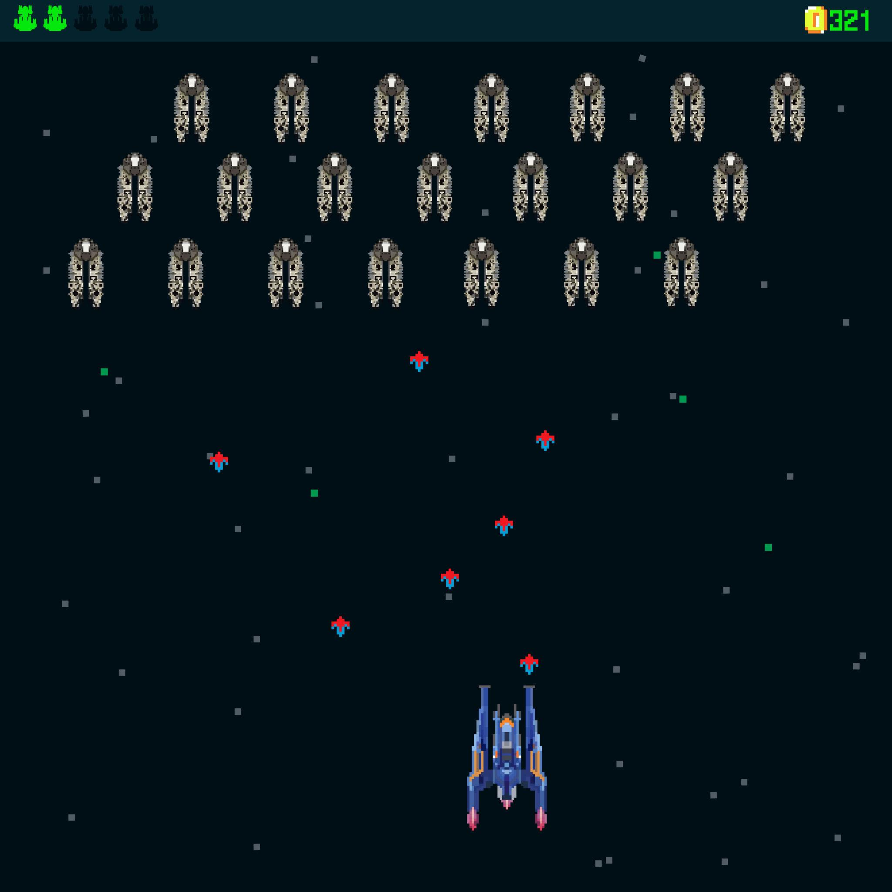
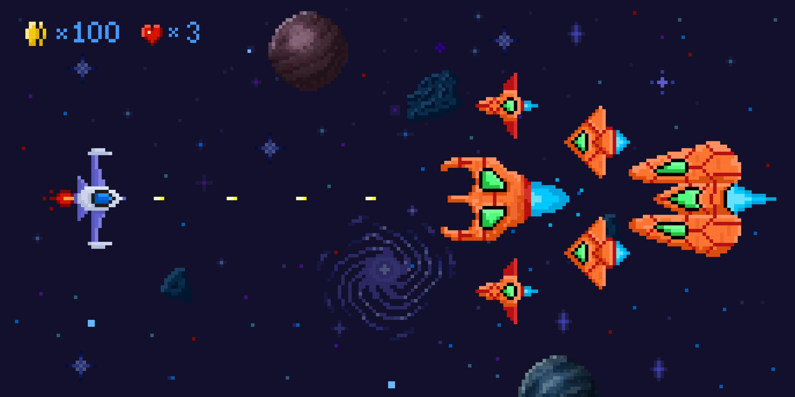
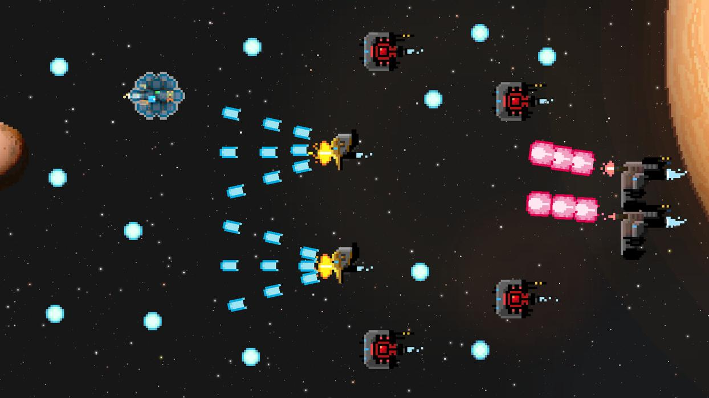
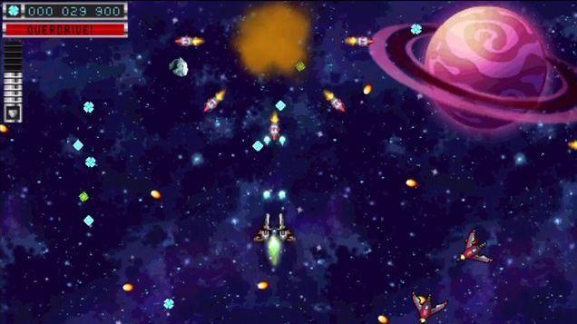

# **🚀 Godot 4 Session 4: Timers, Spawning & Space Shooter**

Engine: Godot 4\
Level: Beginner\
Project: 2D Platformer Adventure: Space Shooter Mini-Project


## **1. Learning Objectives**

By the end of this session, you will be able to:

- Understand how timers work in Godot.
- Use the `timeout` signal to trigger events.
- Understand `PackedScene` and `instantiate()`.
- Create objects dynamically using `add_child()`.
- Generate random positions for enemies.
- Create reusable Bullet and Enemy scenes.
- Shoot bullets when the player presses a button.
- Detect bullet and enemy collisions using `Area2D`.
- Remove objects when they leave the screen.
- Increase the score when enemies are defeated.

## **2. Introduction: How Does a Space Shooter Work?**

<div style="display: flex; gap: 10px;">
  
  
  
</div>

</br>

1. How does the player shoot?
2. Where do the enemies come from?
3. How does the game know that a bullet hit an enemy?
4. How does the score increase?
5. How does the game keep creating new enemies?

### **The basic game logic**

1. The player presses the shooting button.
2. Godot creates a bullet.
3. The bullet moves upward.
4. A timer creates enemies at regular intervals.
5. Enemies move toward the player.
6. Bullets detect enemies using collision areas.
7. When a bullet hits an enemy, both objects disappear.
8. The score increases.

# **Part 1 Understanding Timers**

## **What Is a Timer Node?**

A `Timer` is a Godot node that measures time and triggers an event when the specified time has passed.

We can use timers for:

- Creating enemies every few seconds.
- Controlling how often a player can shoot.
- Starting a countdown.
- Creating power-ups at intervals.
- Increasing difficulty over time.

### **Example**

Imagine we want an enemy to appear every two seconds.

We can create a Timer node with:

| Property  | Value |
| --------- | ----- |
| Wait Time | 2.0   |
| One Shot  | Off   |
| Autostart | On    |

The timer will trigger every two seconds.

## **Understanding the timeout Signal**

When a Timer finishes counting down, it emits a signal called `timeout`.

We can connect this signal to a function.

Example:

```
func _on_timer_timeout() -> void:
    print("Time is up!")
```

**Explain:**

- `timeout` is the signal.
- `_on_timer_timeout()` is the function that runs when the signal is emitted.
- `print()` displays a message in the Output panel.

### **Practice**

1. Create a new scene with a `Node2D` root.
2. Add a `Timer` child.
3. Set Wait Time to 2 seconds.
4. Enable Autostart.
5. Connect the `timeout` signal to the root node.
6. Add the print statement.
7. Run the scene.

Expected output:

```
Time is up!
Time is up!
Time is up!
```

This happens repeatedly because One Shot is disabled.

# **Part 2 Understanding PackedScene and Dynamic Objects**

## **What Is PackedScene?**

Imagine that we want to create 20 enemies in our game.

Do we need to manually add 20 enemies to the scene?

No!

Godot allows us to save a scene and create new copies of it while the game is running.

This is done using `PackedScene`.

**PackedScene** represents a saved scene that can be loaded and instantiated through code.

For example:

- A Bullet scene.
- An Enemy scene.
- A Coin scene.
- A Health Pickup scene.

## **What Does instantiate() Do?**

`instantiate()` creates a new copy of a saved scene.

Example:

```
var bullet_scene = preload("res://scenes/bullet.tscn")

func shoot() -> void:
    var bullet = bullet_scene.instantiate()
```

**Explanation:**

- `preload()` loads the saved scene.
- `bullet_scene` stores the loaded scene resource.
- `instantiate()` creates a new instance of that scene.
- `bullet` represents the newly created object.

However, creating the object does not automatically place it in the game.

We need another function.

## **What Does add_child() Do?**

`add_child()` adds a node to another node in the scene tree.

Example:

```
var bullet = bullet_scene.instantiate()
add_child(bullet)
```

Now the bullet becomes part of the running game.

### **Understand the difference**

| Function        | Purpose                               |
| --------------- | ------------------------------------- |
| `preload()`     | Loads a scene resource                |
| `instantiate()` | Creates a new copy of the scene       |
| `add_child()`   | Adds the new object to the scene tree |

**Remember:** Creating an object and adding it to the game are two different steps.

# **Part 3 Build the Player Spaceship**

## **Create the Player Scene**

We will create a spaceship controlled by the player.

Create a new scene:

1. Add a `CharacterBody2D` root node.
2. Rename it `Player`.
3. Add a `Sprite2D`.
4. Add a `CollisionShape2D`.
5. Assign a suitable collision shape.

Scene structure:

```
Player (CharacterBody2D)
├── Sprite2D
└── CollisionShape2D
```

Save the scene as:

```
res://scenes/player.tscn
```

## **Add Player Movement**

For this space shooter, we will move the spaceship left and right.

Attach this script to Player:

```
extends CharacterBody2D

@export var speed: float = 400.0

func _physics_process(_delta: float) -> void:

    var direction := Input.get_axis(
        "move_left",
        "move_right"
    )

    velocity.x = direction * speed
    velocity.y = 0

    move_and_slide()
```

### **Explain the code**

- `speed`: controls how fast the spaceship moves.
- `Input.get_axis()`: detects left and right movement.
- `velocity.x`: controls horizontal movement.
- `velocity.y = 0`: prevents vertical movement.
- `move_and_slide()`: moves the player while handling collisions.


# **Part 4 Create the Bullet Scene**

## **Build a Reusable Bullet**

When the player presses the shooting button, we want a bullet to appear in front of the spaceship and move upward.

Create a new scene:

1. Add an `Area2D` root node.
2. Rename it `Bullet`.
3. Add a `Sprite2D`.
4. Add a `CollisionShape2D`.
5. Assign a small rectangle or capsule collision shape.

Scene structure:

```
Bullet (Area2D)
├── Sprite2D
└── CollisionShape2D
```

Save it as:

```
res://scenes/bullet.tscn
```

## **Make the Bullet Move**

Attach this script to the Bullet node:

```
extends Area2D

@export var speed: float = 600.0

func _process(delta: float) -> void:
    position.y -= speed * delta
```

### **Explain the code**

- `speed`: controls how fast the bullet moves.
- `_process(delta)`: runs every frame.
- `position.y -=`: moves the bullet upward.
- `delta`: keeps movement consistent across different frame rates.

**Important:** In Godot 2D, the positive Y direction points downward. Therefore, subtracting from Y moves the bullet upward.

## **Remove Bullets That Leave the Screen**

Imagine shooting 100 bullets. If they never disappear, the game will keep creating objects that are no longer needed.

This can affect performance.

Add this to the Bullet script:

```
func _process(delta: float) -> void:
    position.y -= speed * delta

    if position.y < -50:
        queue_free()
```

Now the bullet removes itself when it travels above the screen.

`queue_free()` schedules the bullet for deletion.

# **Part 5 Make the Player Shoot**

## **Add a Shooting Input**

First, we need an input action for shooting.

1. Open **Project → Project Settings**.
2. Select **Input Map**.
3. Add an action named `shoot`.
4. Assign the Space key.

Now the player can shoot by pressing Space.

## **Create a Shooting Signal in Player**

We will let the Player notify Main whenever the player wants to shoot.

Add this to the Player script:

```
signal shoot_requested

func _process(_delta: float) -> void:
    if Input.is_action_just_pressed("shoot"):
        shoot_requested.emit()
```

### **What is&#x20;**`is_action_just_pressed()`**?**

It checks whether the player has just pressed a particular input during the current frame.

The difference:

| Function                    | Meaning                            |
| --------------------------- | ---------------------------------- |
| `is_action_pressed()`       | The button is currently being held |
| `is_action_just_pressed()`  | The button was just pressed        |
| `is_action_just_released()` | The button was just released       |

We use `is_action_just_pressed()` so that one bullet is created per key press.

## **Instantiate and Add the Bullet**

Now we need Main to receive the shooting signal and create a bullet.

We will do this in the Main scene.

The process:

1. Load the Bullet scene.
2. Instantiate a new bullet.
3. Add it to the scene tree.
4. Position it at the spaceship.

Example:

```
@export var bullet_scene: PackedScene

func shoot_bullet() -> void:
    var bullet = bullet_scene.instantiate()

    get_tree().current_scene.add_child(bullet)

    bullet.global_position = $Player.global_position
```

### **Explain the code**

`@export var bullet_scene: PackedScene`

Creates an Inspector property where we can assign the Bullet scene.

`bullet_scene.instantiate()`

Creates a new bullet.

`add_child(bullet)`

Adds the bullet to the running scene.

`bullet.global_position`

Places the bullet at the same global position as the player.

### **Connect the shooting signal**

In Main's `_ready()` function, add:

```
$Player.shoot_requested.connect(shoot_bullet)
```

Now pressing Space causes Main to create a bullet.


# **Part 6 Create the Enemy Scene**

## **Build a Reusable Enemy**

We now need enemies that appear at the top of the screen and move downward.

Create a new scene:

1. Add an `Area2D` root node.
2. Rename it `Enemy`.
3. Add a `Sprite2D`.
4. Add a `CollisionShape2D`.
5. Assign an appropriate collision shape.

Scene structure:

```
Enemy (Area2D)
├── Sprite2D
└── CollisionShape2D
```

Save it as:

```
res://scenes/enemy.tscn
```

Add the Enemy to a Group named:

```
enemies
```

We will use this group to identify enemies when bullets hit them.

## **Make the Enemy Move**

Attach this script to the Enemy:

```
extends Area2D

@export var speed: float = 150.0

func _process(delta: float) -> void:
    position.y += speed * delta
```

### **Explain the code**

- `speed`: controls the enemy's movement speed.
- `position.y +=`: moves the enemy downward.
- `delta`: keeps the movement consistent.

## **Remove Enemies That Leave the Screen**

Add this condition:

```
func _process(delta: float) -> void:
    position.y += speed * delta

    var screen_height = get_viewport_rect().size.y

    if global_position.y > screen_height + 50:
        queue_free()
```

This checks whether the enemy has moved below the visible screen.

If it has, the enemy is removed.


# **Part 7 Spawn Enemies Using a Timer**

## **How Does Enemy Spawning Work?**



We want enemies to appear automatically while the game is running.

Instead of manually placing enemies in the scene, we will use:

- `Timer`
- `timeout`
- `PackedScene`
- `instantiate()`
- `add_child()`
- Random positions

The process:

1. The Timer starts.
2. The Timer reaches its wait time.
3. The `timeout` signal is emitted.
4. Main creates a new enemy.
5. The enemy appears at a random horizontal position.
6. The enemy starts moving downward.

## **Add an Enemy Timer**

Open the Main scene.

1. Select Main.
2. Add a `Timer` child node.
3. Rename it `EnemySpawnTimer`.

Configure it:

| Property  | Value |
| --------- | ----- |
| Wait Time | 2.0   |
| One Shot  | Off   |
| Autostart | On    |

This means an enemy will spawn approximately every two seconds.

## **Load the Enemy Scene**

In the Main script, add:

```
@export var enemy_scene: PackedScene
```

Select Main in the Inspector.

You should see an `Enemy Scene` property.

Drag:

```
res://scenes/enemy.tscn
```

into that property.

This gives Main access to the reusable Enemy scene.

## **Create an Enemy**

Add this function to Main:

```
func spawn_enemy() -> void:
    var enemy = enemy_scene.instantiate()

    add_child(enemy)
```

### **Explain the code**

- `enemy_scene.instantiate()` creates a new enemy.
- `add_child(enemy)` adds it to Main.

At this stage, the enemy will be created, but we still need to decide where it appears.

## **Generate Random X Positions**

We want enemies to appear at different horizontal positions.

Godot provides `randf_range()` to generate a random decimal number between two values.

Example:

```
var random_x = randf_range(50.0, 750.0)
```

This generates a random X position between 50 and 750.

Now update the spawning function:

```
func spawn_enemy() -> void:
    var enemy = enemy_scene.instantiate()

    var random_x = randf_range(50.0, 750.0)

    enemy.position = Vector2(random_x, -50)

    add_child(enemy)
```

The enemy appears above the screen and starts moving downward.

**Important:** The values 50 and 750 are example screen coordinates. We will improve this by using the actual viewport width.

## **Connect the Timer to Enemy Spawning**

Add this to the Main script:

```
func _ready() -> void:
    randomize()

    $EnemySpawnTimer.timeout.connect(spawn_enemy)
```

Now, every time the Timer reaches its wait time, Godot calls `spawn_enemy()`.

Here is a more flexible version of the spawning function:

```
func spawn_enemy() -> void:
    var enemy = enemy_scene.instantiate()

    var screen_width = get_viewport_rect().size.x
    var random_x = randf_range(50.0, screen_width - 50.0)

    enemy.position = Vector2(random_x, -50)

    add_child(enemy)
```

**Explain:**

- `get_viewport_rect().size.x` gets the screen width.
- `randf_range()` chooses a random horizontal position.
- `Vector2(random_x, -50)` places the enemy above the visible screen.

# **Part 8 Detect Bullet and Enemy Collisions**

## **How Does the Game Know a Bullet Hit an Enemy?**

We need Godot to detect when the bullet overlaps an enemy.

Both objects use `Area2D`, so we can use the `area_entered` signal.

Remember:

- `body_entered` detects a physics body entering an Area2D.
- `area_entered` detects another Area2D entering an Area2D.

Since our Bullet and Enemy are both Area2D nodes, we use `area_entered`.

## **Configure Collision Layers and Masks**

For a simple setup, use these settings:

| Object | Collision Layer | Collision Mask |
| ------ | --------------- | -------------- |
| Bullet | 1               | 2              |
| Enemy  | 2               | 1              |

This means:

- The Bullet belongs to layer 1 and detects layer 2.
- The Enemy belongs to layer 2 and detects layer 1.

Make sure:

- Both objects have a `CollisionShape2D`.
- The Bullet's `Monitoring` property is enabled.
- The Enemy's `Monitorable` property is enabled.

## **Detect the Enemy in the Bullet Script**

Update the Bullet script:

```
extends Area2D

signal enemy_destroyed

@export var speed: float = 600.0

func _ready() -> void:
    area_entered.connect(_on_area_entered)

func _process(delta: float) -> void:
    position.y -= speed * delta

    if global_position.y < -50:
        queue_free()

func _on_area_entered(area: Area2D) -> void:
    if area.is_in_group("enemies"):
        enemy_destroyed.emit()
        area.queue_free()
        queue_free()
```

### **Explain the code**

`signal enemy_destroyed`

Creates a custom signal that tells Main an enemy has been destroyed.

`area_entered.connect(_on_area_entered)`

Connects the collision signal to our function through code.

`area.is_in_group("enemies")`

Checks whether the object that entered the bullet's area belongs to the `enemies` group.

`enemy_destroyed.emit()`

Sends a message that an enemy was hit.

`area.queue_free()`

Removes the enemy.

`queue_free()`

Removes the bullet.

Now the bullet and enemy disappear when they overlap.

# **Part 9 Add a Score System**

## **Increase the Score When an Enemy Is Destroyed**

We want the player to earn points for defeating enemies.

For example:

- Destroy one enemy: 10 points.
- Destroy two enemies: 20 points.
- Destroy five enemies: 50 points.

Add a `Label` to your Main scene:

1. Select `CanvasLayer`.
2. Add a `Label`.
3. Rename it `ScoreLabel`.
4. Set its initial text to `Score: 0`.

Your scene structure should look like this:

```
Main (Node2D)
├── Player
├── EnemySpawnTimer
└── CanvasLayer
    └── ScoreLabel
```

## **Update the Main Script**

Add these variables:

```
var score: int = 0

@onready var score_label: Label = $CanvasLayer/ScoreLabel
```

Create a function to increase the score:

```
func _on_enemy_destroyed() -> void:
    score += 10

    score_label.text = "Score: " + str(score)

    print("Current Score: ", score)
```

### **Explain the code**

- `score`: stores the player's points.
- `score += 10`: adds 10 points.
- `str(score)`: converts the score into text.
- `score_label.text`: updates the score displayed on the screen.

## **Connect the Bullet Signal to Main**

When Main creates a bullet, it needs to listen for the bullet's `enemy_destroyed` signal.

Update the shooting function in Main:

```
func shoot_bullet() -> void:
    var bullet = bullet_scene.instantiate()

    add_child(bullet)

    bullet.global_position = $Player.global_position

    bullet.enemy_destroyed.connect(_on_enemy_destroyed)
```

Now the sequence is:

1. Player presses Space.
2. Main creates a bullet.
3. Bullet hits an enemy.
4. Bullet emits `enemy_destroyed`.
5. Main receives the signal.
6. Score increases by 10.

# **Part 10 Complete Project Setup**

## **Main Scene Structure**

Your Main scene should look like this:

```
Main (Node2D)
├── Player (CharacterBody2D)
├── EnemySpawnTimer (Timer)
└── CanvasLayer
    └── ScoreLabel (Label)
```

The Bullet and Enemy are separate reusable scenes:

```
Bullet (Area2D)
├── Sprite2D
└── CollisionShape2D
```

```
Enemy (Area2D)
├── Sprite2D
└── CollisionShape2D
```

## **Complete Player Script**

Attach this to the Player scene:

```
extends CharacterBody2D

signal shoot_requested
@export var speed: float = 400.0

func _physics_process(_delta: float) -> void:
	var direction := Input.get_axis(
		"move_left",
        "move_right"
	)
	velocity.x = direction * speed
	velocity.y = 0
	move_and_slide()

func _process(_delta: float) -> void:
	if Input.is_action_just_pressed("shoot"):
		shoot_requested.emit()
```

## **Complete Bullet Script**

Attach this to the Bullet scene:

```
extends Area2D

signal enemy_destroyed
@export var speed: float = 600.0

func _ready() -> void:
	area_entered.connect(_on_area_entered)

func _process(delta: float) -> void:
	position.y -= speed * delta
	if global_position.y < -50:
		queue_free()

func _on_area_entered(area: Area2D) -> void:
	print("Bullet detected an area: ", area.name)

	if area.is_in_group("enemies"):
		print("ENEMY HIT!")
		enemy_destroyed.emit()
		area.queue_free()
		queue_free()
```

## **Complete Enemy Script**

Attach this to the Enemy scene:

```
extends Area2D

@export var speed: float = 150.0

func _ready() -> void:
	body_entered.connect(_on_body_entered)

func _process(delta: float) -> void:
	position.y += speed * delta
	var screen_height = get_viewport_rect().size.y
	if global_position.y > screen_height + 50:
		queue_free()

func _on_body_entered(body: Node2D) -> void:
	if body.is_in_group("player"):
		print("Player hit!")
		body.queue_free()
		queue_free()
		get_tree().call_group("game_manager", "game_over")

```

## **Complete Main Script**

Attach this to the Main scene:

```
extends Node2D

@export var bullet_scene: PackedScene
@export var enemy_scene: PackedScene
@onready var game_over_label: Label = $CanvasLayer/GameOverLabel
var score: int = 0

@onready var score_label: Label = $CanvasLayer/ScoreLabel
@onready var player = $Player
@onready var enemy_timer: Timer = $EnemySpawnTimer

func _ready() -> void:
	randomize()
	player.shoot_requested.connect(shoot_bullet)
	enemy_timer.timeout.connect(spawn_enemy)
	enemy_timer.wait_time = 2.0
	enemy_timer.start()

func shoot_bullet() -> void:
	var bullet = bullet_scene.instantiate()
	add_child(bullet)
	bullet.global_position = player.global_position
	bullet.enemy_destroyed.connect(_on_enemy_destroyed)

func spawn_enemy() -> void:
	var enemy = enemy_scene.instantiate()
	add_child(enemy)
	var screen_width = get_viewport_rect().size.x
	var random_x = randf_range(50.0, screen_width - 50.0)
	enemy.global_position = Vector2(random_x, -50)

func _on_enemy_destroyed() -> void:
	score += 10
	score_label.text = "Score: " + str(score)
	print("Current Score: ", score)
	
func game_over() -> void:
	game_over_label.visible = true
	enemy_timer.stop()
	get_tree().paused = true

```

### **Important setup in the Inspector**

Select Main and assign:

- `Bullet Scene` → `bullet.tscn`
- `Enemy Scene` → `enemy.tscn`

Select `EnemySpawnTimer`:

| Property  | Value |
| --------- | ----- |
| Wait Time | 2.0   |
| One Shot  | Off   |
| Autostart | Off   |

We start the timer through code after connecting its signal.


# **Part 11 Challenges**

## **Challenge A — Increase Difficulty Gradually**

**Objective:** Make the game more challenging as time passes.

**Option 1: Increase enemy spawning speed**

Start with one enemy every two seconds.

After 15 seconds, decrease the wait time to 1.5 seconds.

After 30 seconds, decrease it to 1 second.

Example:

```
func increase_difficulty() -> void:
    if enemy_timer.wait_time > 0.8:
        enemy_timer.wait_time -= 0.2
```

You can call this function using another Timer every 15 seconds.

**Option 2: Increase enemy speed**

Start enemies at 150 pixels per second.

Gradually increase their speed.

Example:

```
enemy.speed += 20
```

## **Challenge B — Add Different Enemy Types**

Create two enemy types:

- Slow enemy: moves at 100 pixels per second.
- Fast enemy: moves at 250 pixels per second.


The goal is to make the game more interesting by introducing different levels of difficulty.


# **Part 12 Common Problems and Solutions**

## **Why Are Bullets Not Appearing?**

Check:

- Is `bullet.tscn` assigned to the Bullet Scene property in Main?
- Is the Player's `shoot_requested` signal connected?
- Is the `shoot` action configured in Input Map?
- Is `shoot_bullet()` being called?
- Is the Bullet scene saved correctly?

## **Why Are Enemies Not Spawning?**

Check:

- Is `enemy.tscn` assigned to the Enemy Scene property?
- Is the Timer named `EnemySpawnTimer`?
- Is the `timeout` signal connected?
- Is the Timer started?
- Is `spawn_enemy()` being called?

Add this line to test:

```
func spawn_enemy() -> void:
    print("Spawning enemy!")

    var enemy = enemy_scene.instantiate()
    add_child(enemy)
```

If you see the message repeatedly in Output, the Timer is working.

## **Why Are Bullets Not Destroying Enemies?**

Check:

- Are both Bullet and Enemy `Area2D` nodes?
- Do both have `CollisionShape2D` children?
- Is the Bullet's Monitoring enabled?
- Is the Enemy's Monitorable enabled?
- Does the Bullet's collision mask include the Enemy's layer?
- Does the Enemy belong to the `enemies` group?
- Is `area_entered` connected?

# **Part 13 Final Review**

## **Questions**

1. What is the purpose of a Timer node?
2. What happens when the `timeout` signal is emitted?
3. What is the difference between `instantiate()` and `add_child()`?
4. What does `PackedScene` represent?
5. Why do we use random positions when spawning enemies?
6. What is the difference between `body_entered` and `area_entered`?
7. Why do we use `queue_free()`?
8. Why should bullets be removed after leaving the screen?
9. How can we increase the difficulty of a space shooter?
10. How does the score increase when an enemy is destroyed?

## **Final Learning Checkpoint**

By the end of this session, every student should be able to independently:

- Create reusable scenes.
- Instantiate objects through code.
- Add objects to the scene tree.
- Use a Timer to spawn enemies.
- Generate random positions.
- Make bullets and enemies move.
- Detect collisions between Area2D nodes.
- Remove objects after collisions.
- Update a score using signals.

## **Concepts**

- **Timer:** Controls when something happens.
- **PackedScene:** Represents a reusable saved scene.
- **instantiate():** Creates a new object from a scene.
- **add_child():** Adds the object to the scene tree.
- **Signals:** Allow objects to communicate when events happen.
- **Area2D:** Detects overlaps between objects.
- **queue_free():** Removes objects safely.

