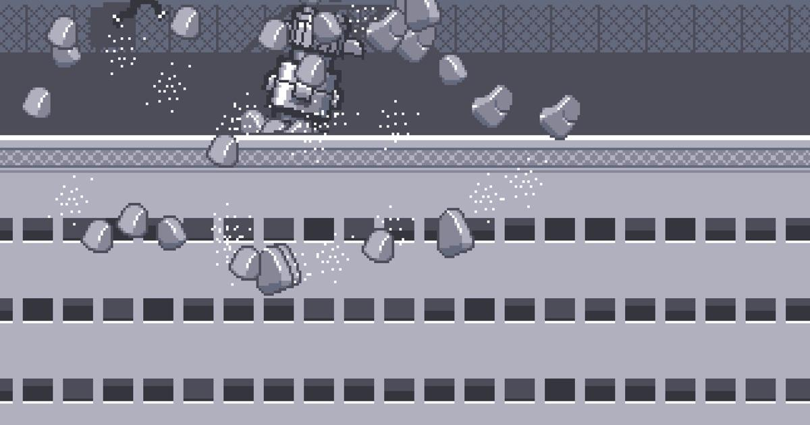

## **Turn the Spawn Logic into an Endless Runner**

**Falling Obstacles**

Students will reuse the enemy spawning system to create falling obstacles for an Endless Runner.

### **Requirements**

1. Create an Endless Runner player.
2. Create a reusable obstacle scene.
3. Use a Timer to spawn obstacles.
4. Use random X positions.
5. Make obstacles move downward.
6. Detect collisions between the player and obstacles.
7. Remove obstacles when they leave the screen.
8. Increase difficulty over time.

### **Optional Challenge**

Add a score that increases as the player survives.

